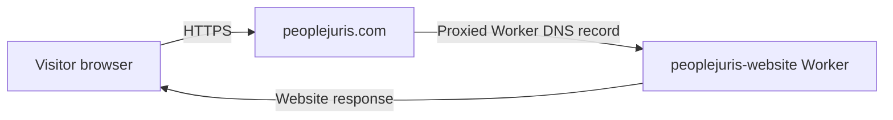
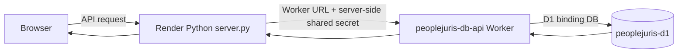

# 02 — System Architecture

## Architecture at a glance

**The supplied Cloudflare dashboard screenshots change the earlier interpretation:** the current Cloudflare Workers & Pages list shows two applications named `peoplejuris-website` and `peoplejuris-db-api`. The opened project detail screens identify both as **Workers**. The screenshots do not show a separate Pages project for the current `peoplejuris.com` site.

The evidence-backed topology is:

1. GoDaddy is the domain registrar for `peoplejuris.com` (owner-confirmed). Cloudflare is configured to manage the domain's DNS zone; its dashboard shows the proxied apex Worker record for the same domain.
2. `peoplejuris.com` is a Cloudflare DNS Worker record, proxied, targeting the `peoplejuris-website` Worker.
3. `peoplejuris-website` is the website/frontend entry point. Its overview shows **Bindings: 0**. The dashboard list shows the GitHub repository `Binaya1997/peoplejuris-website` connected to this app. The deployed static-asset behavior is consistent with the repository's `wrangler.jsonc` configuration (`assets.directory` set to `.`), but the screenshot alone does not prove every runtime implementation detail.
4. `peoplejuris-db-api` is a separate Cloudflare Worker exposed at `peoplejuris-db-api.patnaikbinaya61.workers.dev`. Its detail screen shows one D1 binding: `DB` → `peoplejuris-d1`.
5. The owner-confirmed Render service `https://peoplejuris-feature-api.onrender.com` runs the Python backend (`server.py`). The Python D1 adapter communicates server-to-server with `peoplejuris-db-api`; the Worker uses its `DB` binding to access D1.
6. The Python backend uses the GitHub Contents API for newsletter PDF and cover-image storage, per the supplied `github_storage.py` source and owner confirmation.

[SVG](diagrams/01-platform-architecture.svg) · [Editable Graphviz source](diagrams/01-platform-architecture.dot)

## Current Cloudflare dashboard evidence

| Dashboard item | What the screenshot shows | Architecture meaning |
|---|---|---|
| Workers & Pages list | `peoplejuris-website` and `peoplejuris-db-api` | Two separate deployed applications are listed. |
| `peoplejuris-website` | GitHub repository `Binaya1997/peoplejuris-website`; `peoplejuris.com + 1 other route` in the listing | Website Worker is associated with the GitHub repository and custom domain. Exact build/trigger details still need checking. |
| Website Worker detail | Custom domain `peoplejuris.com`; `workers.dev` marked Disabled; Bindings `0`; Workers `0` | This is the public website Worker entry point and does not show a D1 binding. |
| Registrar | GoDaddy — owner-confirmed | Domain registration/renewal provider; not part of the per-request web traffic path. |
| DNS provider | Cloudflare — DNS zone and proxied Worker record visible in the supplied dashboard | Manages DNS records and routes the apex domain to `peoplejuris-website`. |
| DNS zone/record | Name `peoplejuris.com`, type `Worker`, content `peoplejuris-website`, proxied | The apex domain is routed through Cloudflare to the website Worker. |
| `peoplejuris-db-api` | `peoplejuris-db-api.patnaikbinaya61.workers.dev` | This is a distinct Worker API endpoint. |
| D1 API Worker detail | One binding: D1 database binding name `DB` → `peoplejuris-d1` | D1 access is attached to the API Worker, not the website Worker. |
| D1 database list | `peoplejuris-d1`; dashboard reported `Tables: 0`, `Queries: 353`, `Size: 69.63 kB` | This conflicts with the previously supplied migration output listing three application tables. Verify live schema before relying on the ERD or applying a migration. |
| DNS recommendation | Cloudflare says visitors cannot reach `www.peoplejuris.com` and recommends an A/AAAA/CNAME record and optionally a redirect | `www` is a separate unresolved DNS item. No DNS change is made or recommended as part of this documentation update. |

The screenshots were supplied on 1 November 2026. They represent a dashboard snapshot, not a continuous health check. No D1 query or DNS/route change was run during this documentation update.

## Domain and DNS responsibilities

- **GoDaddy** is the domain registrar for `peoplejuris.com`; registration and renewal belong here.
- **Cloudflare** is configured to manage the domain's DNS zone. The supplied dashboard shows the proxied apex Worker record routing `peoplejuris.com` to `peoplejuris-website`.
- GoDaddy is not the normal live HTTP hop for each browser request. Cloudflare handles DNS resolution and edge routing for the configured domain.

## Service responsibilities

- **Cloudflare Worker `peoplejuris-website`**: public website/frontend entry point for the apex custom domain `peoplejuris.com`. The screenshot shows no D1 binding on this Worker. Do not draw it as the database gateway.
- **Cloudflare Worker `peoplejuris-db-api`**: private/server-to-server data API gateway used by the Python D1 adapter. Its D1 binding is named `DB` and points to `peoplejuris-d1`. Keep the shared Worker secret server-side.
- **Cloudflare D1 `peoplejuris-d1`**: intended production database for admin accounts, sessions and newsletter metadata according to owner confirmation and prior migration output. Current table count is not reconciled; verify the actual live schema.
- **Render**: Python runtime. The supplied `render.yaml` and `Procfile` start `python server.py`; owner confirms the service URL above.
- **GitHub**: source repository and newsletter-file storage. Dashboard shows the website Worker connected to the `Binaya1997/peoplejuris-website` repository. Exact automatic deployment trigger rules are not shown in the screenshots.
- **Browser**: requests the public website at `peoplejuris.com` and calls the backend API. The exact API origin embedded in the deployed frontend and the exact production environment variable values still need checking.

## Request paths

### Public website page

### Backend and database API

**Important:** do not connect `peoplejuris-website` directly to D1 in diagrams or instructions. Its dashboard shows zero bindings; the `DB` binding is on `peoplejuris-db-api`.

## Deployment and source relationship

- The Cloudflare Workers & Pages list shows `peoplejuris-website` associated with `Binaya1997/peoplejuris-website`. This supports a GitHub integration, but the exact build command, branch filters, and auto-deploy behavior were not fully visible.
- The supplied source ZIP contains `wrangler.jsonc` for `peoplejuris-website` with static assets directory `.`. It does not contain the separate D1 API Worker source/migration directory.
- Render is owner-confirmed deployed, and the source repository includes Render configuration. The screenshots supplied here do not show Render's current GitHub integration, branch, or deployment trigger.
- The `peoplejuris-db-api` Worker release/source integration is not shown in the supplied screenshots.

## Newsletter storage path

The Python backend validates newsletter uploads, writes PDF/cover files through `github_storage.py` and persists newsletter metadata through the D1 adapter. These are separate operations and can partially fail. D1 stores metadata/paths; GitHub stores the binary files, according to the source and owner confirmation.

## D1 schema discrepancy — must be resolved

The previously supplied migration output described `admins`, `sessions`, and `newsletters`. The latest D1 dashboard screenshot instead reports **0 tables** for `peoplejuris-d1`, despite showing 353 queries and 69.63 kB in size. That may reflect an empty database, a dashboard/statistics issue, a different target/database, or another mismatch; the screenshot alone cannot determine which explanation is correct.

Use the D1 Console read-only checks in [07 — Cloudflare D1 Migration](07-cloudflare-d1-migration.md) to enumerate the live schema. Until reconciled:

- Treat the three-table ERD as a **previously observed/expected schema**, not proof of current production state.
- Do not apply `CREATE TABLE`, reset, or migration commands just to make the dashboard count change.
- Do not alter admin or newsletter data until the intended database and current schema are confirmed.

## Architecture evidence boundaries

- Cloudflare product names, Worker names, apex domain Worker routing, Worker binding counts, D1 binding name/target, and D1 table-count display are taken from the supplied screenshots. GoDaddy registrar status is owner-confirmed; Cloudflare DNS configuration is shown in the supplied dashboard.
- Render URL, production data purpose, and GitHub newsletter storage are owner-confirmed or supported by supplied source.
- Exact frontend API URL, live Render environment variables, Worker secret configuration, deployment triggers, and D1 current schema remain unverified.
- No DNS, route, Worker, Render, or D1 settings were changed while updating these documents.
