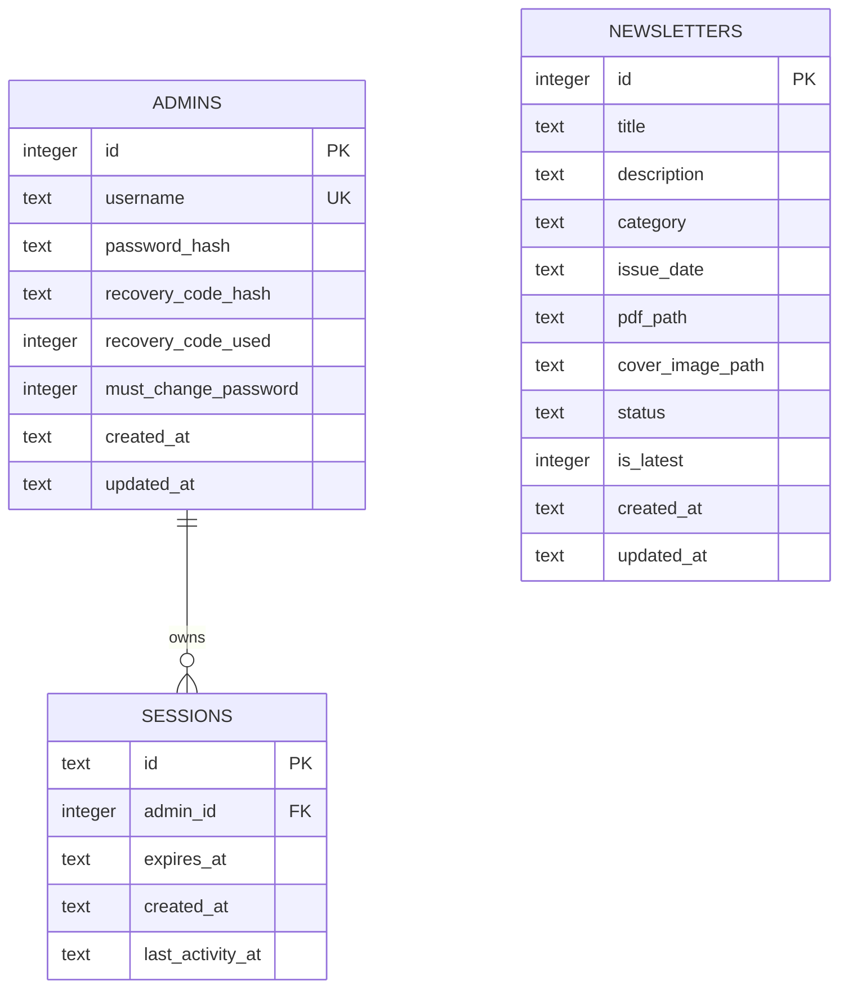

# 06 — Database Schema and Data Model

## Database roles

- **Cloudflare D1**: owner-confirmed production database for admin accounts, sessions and newsletter metadata.
- **SQLite**: local/default adapter and a prior/alternative database mode. `PJ_DB_PATH` selects its file location.
- Newsletter binary assets are owner-confirmed to reside in GitHub repository storage, not as BLOBs in D1.

## D1 schema from previously inspected migration — current presence unverified

The D1 dashboard screenshot supplied on 1 November 2026 reports `peoplejuris-d1` with **0 tables**, 353 queries, and 69.63 kB. This conflicts with the prior migration output below. The screenshot may reflect an empty/wrong database target or a dashboard/statistics discrepancy; it is not enough to determine which. Treat the schema below as the previously observed/expected schema, not proof that these tables exist in the active production database.

Before any migration or write, use Cloudflare D1 Console to run read-only checks (one at a time):

```sql
SELECT name, type FROM sqlite_master
WHERE type IN ('table', 'index')
ORDER BY type, name;

SELECT name FROM sqlite_master
WHERE type = 'table' AND name NOT LIKE 'sqlite_%'
ORDER BY name;

PRAGMA table_info('admins');
PRAGMA table_info('sessions');
PRAGMA table_info('newsletters');
```

If the first two queries return no application tables, stop and identify the intended account/database/binding and migration history. Do not run `CREATE TABLE`, migrations, resets, or seed operations just to force the dashboard count to change.

The prior `worker-d1-api/migrations/0001_initial_schema.sql` output defined:

```sql
CREATE TABLE IF NOT EXISTS admins (
    id INTEGER PRIMARY KEY AUTOINCREMENT,
    username TEXT UNIQUE NOT NULL,
    password_hash TEXT NOT NULL,
    recovery_code_hash TEXT,
    recovery_code_used INTEGER DEFAULT 0,
    must_change_password INTEGER DEFAULT 0,
    created_at TEXT NOT NULL,
    updated_at TEXT NOT NULL
);

CREATE TABLE IF NOT EXISTS sessions (
    id TEXT PRIMARY KEY,
    admin_id INTEGER NOT NULL,
    expires_at TEXT NOT NULL,
    created_at TEXT NOT NULL,
    last_activity_at TEXT NOT NULL,
    FOREIGN KEY (admin_id) REFERENCES admins(id) ON DELETE CASCADE
);

CREATE TABLE IF NOT EXISTS newsletters (
    id INTEGER PRIMARY KEY AUTOINCREMENT,
    title TEXT NOT NULL,
    description TEXT,
    category TEXT,
    issue_date TEXT NOT NULL,
    pdf_path TEXT NOT NULL,
    cover_image_path TEXT NOT NULL,
    status TEXT NOT NULL DEFAULT 'published',
    is_latest INTEGER NOT NULL DEFAULT 0,
    created_at TEXT NOT NULL,
    updated_at TEXT NOT NULL
);

CREATE INDEX IF NOT EXISTS idx_admins_username ON admins(username);
CREATE INDEX IF NOT EXISTS idx_sessions_admin_id ON sessions(admin_id);
CREATE INDEX IF NOT EXISTS idx_sessions_expires_at ON sessions(expires_at);
CREATE INDEX IF NOT EXISTS idx_sessions_last_activity_at ON sessions(last_activity_at);
CREATE INDEX IF NOT EXISTS idx_newsletters_status_latest_date
    ON newsletters(status, is_latest, issue_date DESC);
CREATE INDEX IF NOT EXISTS idx_newsletters_issue_date
    ON newsletters(issue_date DESC);
```

This is a prior-provided migration schema, not freshly extracted from the supplied ZIP, and its presence in the active `peoplejuris-d1` database is not yet verified. The D1 Worker source and all later migrations are not included in the ZIP.

## Column descriptions

### `admins`
- `id`: integer primary key.
- `username`: unique required login name.
- `password_hash`: PBKDF2 encoded hash.
- `recovery_code_hash`: hashed one-time recovery code; nullable.
- `recovery_code_used`: flag for consumed recovery code.
- `must_change_password`: first-login/password-reset change flag.
- `created_at`, `updated_at`: timestamp text.

### `sessions`
- `id`: session token primary key.
- `admin_id`: foreign key to `admins.id`, cascading on admin deletion.
- `expires_at`: absolute expiry timestamp.
- `created_at`: creation timestamp.
- `last_activity_at`: activity timestamp used for inactivity expiry.

### `newsletters`
- `id`: integer primary key.
- `title`, `description`, `category`: public/admin metadata.
- `issue_date`: publication/issue date.
- `pdf_path`, `cover_image_path`: asset paths or configured URLs.
- `status`: publication state, default `published`.
- `is_latest`: latest-edition flag.
- `created_at`, `updated_at`: timestamp text.

## ERD



## Latest newsletter behavior

The backend contains logic to ensure a single published latest record: it clears `is_latest` on other newsletter records and sets the target record latest only if published. A fallback function promotes the newest published record when no published latest record exists. Verify exact active behavior in the relevant adapter/Worker implementation before manual SQL edits.

## Data access and backup

D1 dashboard table count discrepancy must be resolved before relying on this model. The ERD describes the prior migration output only.

SQLite access enables foreign keys and uses parameterized queries. D1 access is through the Worker API and a shared secret. A verified production backup/restore procedure is **unknown**. Do not treat the repository ZIP or Git history as a database backup.
