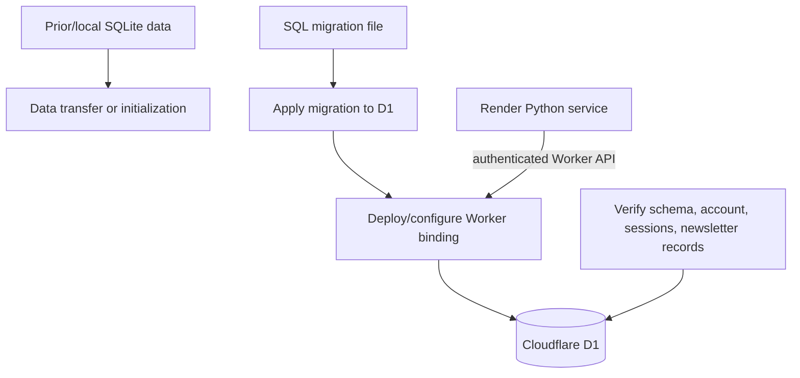

# 07 — Cloudflare D1 Migration

## Current understanding

Owner confirms Cloudflare D1 is the production database. Prior project context records a migration/establishment of D1 and a Worker API. The supplied ZIP contains a Python D1 adapter but not the separate Worker source, D1 migrations, or full migration command history.

A previous terminal output showed `worker-d1-api/migrations/0001_initial_schema.sql` with `admins`, `sessions`, and `newsletters` tables and indexes. This is documented as evidence, not a complete migration history.

**New Cloudflare dashboard evidence (1 November 2026):** the D1 database list shows `peoplejuris-d1` with `Tables: 0`, `Queries: 353`, and `Size: 69.63 kB`. This conflicts with the prior three-table migration output. The current live schema must be checked before migration, reset, restore, or data writes. Do not infer that 353 queries means the tables exist. It is possible the dashboard is displaying a different/empty target or statistics have not caught up; available screenshots cannot decide this.

### Read-only schema verification in D1 Console

Select the database `peoplejuris-d1` in Cloudflare D1 Console, then execute these read-only queries individually:

```sql
SELECT name, type FROM sqlite_master
WHERE type IN ('table', 'index')
ORDER BY type, name;

SELECT name FROM sqlite_master
WHERE type = 'table' AND name NOT LIKE 'sqlite_%'
ORDER BY name;

PRAGMA table_info('admins');
PRAGMA table_info('sessions');
PRAGMA table_info('newsletters');
```

Expected application tables based on the previous migration artifact are `admins`, `sessions`, and `newsletters`. If they are absent, stop. Confirm the Cloudflare account, selected D1 database, `DB` binding target on `peoplejuris-db-api`, and applied migration history before proposing any write. Do not create tables or rerun migrations without reviewing current state and obtaining explicit approval.

## Components

- Worker project: previously identified as `worker-d1-api`.
- Worker name in that project's Wrangler configuration: `peoplejuris-db-api`.
- Worker entry: `src/index.ts`.
- D1 binding: `DB`.
- D1 database name: `peoplejuris-d1`.
- Python config chooses D1 when `PJ_DB_BACKEND=d1`.
- Worker URL and secret are configured in the Python service environment.

Database ID and secret values are intentionally not reproduced.

## Migration path (evidence-based, with gaps)



The exact historical data export/import commands, sequence, and validation totals are unavailable from the present materials. Do not invent them. The current D1 dashboard screenshot makes the live schema state an open verification item.

## Safe maintenance checklist

1. Identify the intended D1 database by account/project, database name and configured binding.
2. Verify the environment is production or nonproduction before running a write.
3. Read current migration files and check applied migration history.
4. Take a database backup using the current supported Cloudflare mechanism before schema/data changes.
5. Apply only a reviewed migration to the intended database.
6. Verify tables, indexes, row counts and app behavior.
7. Keep rollback plan separate; D1 schema rollback may require a forward corrective migration or restore.

## Local vs remote D1

Local D1 is Wrangler's local development database state. Remote D1 is the Cloudflare-hosted database. A local migration or local SQL query does not prove remote production state. Conversely, a remote command can change production. Always make the target explicit and inspect CLI help/version for the installed Wrangler.

## Commands

The following are **maintenance examples, not verified historical commands**; confirm Wrangler version and project config before execution:

```bash
# From the Worker project, inspect config and CLI
npx wrangler --version
npx wrangler d1 list

# Inspect the local database (example only)
npx wrangler d1 execute peoplejuris-d1 --local --command "SELECT name FROM sqlite_master WHERE type='table';"

# Remote query (read-only SQL; verify account/database target first)
npx wrangler d1 execute peoplejuris-d1 --remote --command "SELECT name FROM sqlite_master WHERE type='table';"
```

Never execute remote writes or migrations as a documentation step. Current backup/restore and full migration chronology remain missing.
