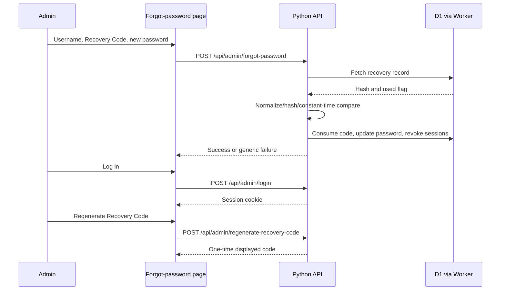

# 11 — Admin Authentication and Recovery

## Password hashing

`server.py` implements PBKDF2-HMAC-SHA256 with 600,000 iterations and a random 16-byte salt. Encoded format:

`pbkdf2:sha256:<iterations>$<salt hex>$<derived key hex>`

Password verification uses constant-time comparison. Never publish password hashes or temporary credentials.

## Session behavior

- Cookie name: `pj_admin_session`.
- Cookie attributes in source: `Path=/`, `HttpOnly`, `SameSite=None`, `Secure`.
- 15-minute inactivity timeout.
- 12-hour absolute lifetime.
- Successful authenticated API calls may refresh the cookie.
- Session data is stored in the active DB adapter.
- Logout deletes the session and clears the cookie.
- Password recovery consumes the code and invalidates sessions.
- Password change invalidates other active sessions according to adapter method behavior.

## Login and rate limiting

Source documents 5 failed attempts in a 15-minute window. Rate limiting is an in-memory Python dictionary, so its scope and durability are process-local. Successful login clears relevant attempt history. This behavior should be checked against production multi-instance conditions.

## Recovery Code

- Generated as a 16-character cryptographically selected code formatted `XXXX-XXXX-XXXX-XXXX`.
- Ambiguous characters are excluded.
- Code is normalized before SHA-256 hashing.
- Only the hash is stored in the database.
- The code is shown once when generated.
- Recovery validates username, unused state and code hash, updates password hash, consumes code, and invalidates sessions.
- Admin dashboard has Recovery Code regeneration; owner confirms it is available.

## Owner-confirmed recent manual D1 recovery

The user reported forgetting access credentials and manually updated the existing Owner account in D1 using a locally generated PBKDF2 hash. The update set password hash, cleared recovery-code hash, marked code used, set `must_change_password=1`, and updated timestamp. The user then confirmed login succeeded.

This procedure is documented without the temporary password or hash. It is a record of the recent recovery, not a recommended routine process. A fresh Recovery Code should be generated in the authenticated dashboard after the password is changed.

## Recovery sequence



## Initial account provisioning

`python server.py --setup-admin` invokes interactive setup and `db.upsert_admin`. It can read `PJ_ADMIN_USER` and `PJ_ADMIN_PASS` from environment. It generates a recovery code and prints it once.

The supplied `run_server()` also contains an automatic initial-admin fallback when the admin count is zero, using a hardcoded temporary password and requiring password change. This is a security-sensitive behavior: it is documented as found in source, not endorsed. Before any deployment, confirm the account already exists and avoid triggering this fallback unexpectedly.

## Manual D1 emergency recovery — password AND Recovery Code unavailable

Use this only when the Owner cannot use the self-service forgot-password page because both the password and the one-time Recovery Code are unavailable. This is a manual production database intervention, not the normal recovery route.

### Before starting

1. Open the Cloudflare dashboard and select **D1 → `peoplejuris-d1` → Console**. The production data store must be selected explicitly. The local clone's SQLite database is not the production target.
2. Confirm the live database has the expected tables and the intended admin row. The Cloudflare D1 list screenshot supplied on 1 November 2026 showed `0` tables, which conflicts with the earlier migration output. If `admins` or `sessions` is missing, or the target row is not returned, **stop**. Do not create tables or run a migration as part of password recovery.
3. Confirm a recoverable backup/export is available before writing to production. The project's backup/restore process has not yet been documented as tested; do not describe an untested export as a verified backup.
4. Confirm the exact target row. The example below uses `id = 1` and `username = 'admin'` because that is the account targeted in the owner's recovery command. Do not assume those identifiers for another account.

Read-only pre-checks in the D1 Console:

```sql
-- Check which tables exist in the selected D1 database.
SELECT name
FROM sqlite_master
WHERE type = 'table'
ORDER BY name;

-- Confirm the exact admin row before changing it.
SELECT id, username, recovery_code_used, must_change_password
FROM admins
WHERE id = 1 AND username = 'admin';
```

If either query errors or the second query returns no row, stop and resolve the database/identity mismatch first.

### Step 1 — Generate a new temporary password hash locally

Run this from the project root in the local clone (the folder containing `server.py`). This uses the application's own `hash_password()` function, which produces the PBKDF2-HMAC-SHA256 format expected by the login code. It does not perform the database UPDATE.

```bash
python3 - <<'PYCODE'
import getpass
from server import hash_password

password = getpass.getpass("Enter NEW temporary admin password: ")
if len(password) < 12:
    raise SystemExit("Use a temporary password with at least 12 characters.")

print("\nGenerated password hash:\n")
print(hash_password(password))
PYCODE
```

Copy the generated hash for the next step. Do not put the plaintext password or hash in Git, a ticket, chat, screenshots, or this documentation. The previously pasted sample temporary password is exposed in the conversation; never reuse it. Generate a new one.

### Step 2 — Update only the confirmed admin row in D1

In **Cloudflare Dashboard → D1 → `peoplejuris-d1` → Console**, replace `<PASTE_NEW_GENERATED_HASH_HERE>` with the hash generated in Step 1, then run:

```sql
UPDATE admins
SET
    password_hash = '<PASTE_NEW_GENERATED_HASH_HERE>',
    recovery_code_hash = NULL,
    recovery_code_used = 1,
    must_change_password = 1,
    updated_at = datetime('now')
WHERE id = 1
  AND username = 'admin';
```

This intentionally disables the old Recovery Code (`NULL` hash and `recovery_code_used = 1`). It does not generate a replacement code.

### Step 3 — Revoke existing sessions

The original UPDATE command does not delete existing session rows. Run this as a separate statement so previously issued admin sessions are revoked:

```sql
DELETE FROM sessions
WHERE admin_id = 1;
```

Use the same confirmed admin ID from the pre-check. If the `sessions` table is absent, stop and investigate rather than guessing at a schema.

### Step 4 — Verify the result

Run:

```sql
SELECT
    id,
    username,
    recovery_code_used,
    must_change_password,
    updated_at
FROM admins
WHERE id = 1
  AND username = 'admin';

SELECT COUNT(*) AS remaining_admin_sessions
FROM sessions
WHERE admin_id = 1;
```

Expected result: exactly the intended admin row is returned, `recovery_code_used = 1`, `must_change_password = 1`, and `remaining_admin_sessions = 0`. Do not query or paste `password_hash` into logs or support messages.

### Step 5 — Log in and finish account recovery

1. Open the normal Admin Login page and sign in using the username and the new temporary password used in Step 1.
2. The current dashboard source checks `must_change_password` and displays a security banner with a **Change Password** button. This is a dashboard reminder; the supplied source does not show a hard login block that forces the change automatically.
3. Open **Change Password**, enter the temporary password as the current password, choose a new unique long-term password, and save it. The backend sets `must_change_password = 0` and invalidates other sessions while retaining the current session.
4. In the dashboard choose **Regenerate Backup Code** / **Regenerate Recovery Code**. The new code is displayed once. Save it offline in an approved password manager or other secure location. Do not leave it in screenshots, source control, chat, or ordinary notes.
5. Log out and sign in again with the new long-term password. Confirm the dashboard works and that the new Recovery Code is stored securely.

### Important behavior and limits

- Setting `recovery_code_hash = NULL` and `recovery_code_used = 1` intentionally makes the old Recovery Code unusable. A new code must be generated after login.
- Setting `must_change_password = 1` causes the current dashboard to display its security banner; the source reviewed does not enforce an automatic password-change redirect.
- The SQL changes D1 directly. It does not change the Python source, Cloudflare Worker code, Render environment variables, DNS, or GitHub files.
- Never run this against a local SQLite database while believing it is the Cloudflare D1 production database. Hash generation is local; the SQL write must be made only in the explicitly selected, confirmed D1 database.
- Do not store the generated hash, temporary password, or Recovery Code in this manual. This runbook records the process and safe placeholders only.
