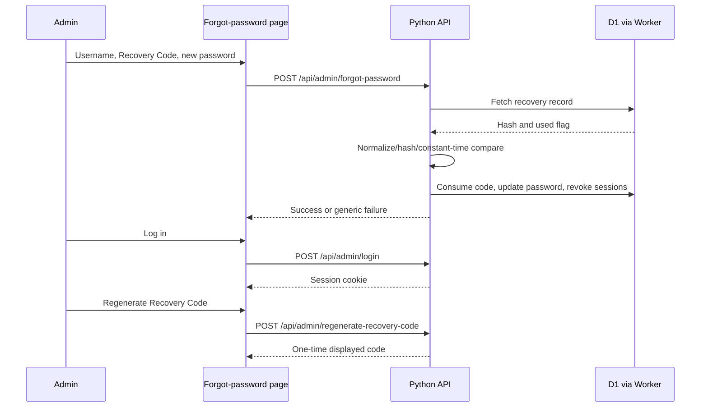

# 11 — Admin Authentication and Recovery

## Password hashing

`server.py` implements PBKDF2-HMAC-SHA256 with 600,000 iterations and a random 16-byte salt. Encoded format:

`pbkdf2:sha256:<iterations>$<salt hex>$<derived key hex>`

Password verification uses constant-time comparison. Never publish password hashes or temporary credentials.

## Session behavior

- Cookie name: `pj_admin_session`.
- Cookie attributes in source: `Path=/`, `HttpOnly`, `SameSite=None`, `Secure`.
- 15-minute inactivity timeout.
- 12-hour absolute lifetime.
- Successful authenticated API calls may refresh the cookie.
- Session data is stored in the active DB adapter.
- Logout deletes the session and clears the cookie.
- Password recovery consumes the code and invalidates sessions.
- Password change invalidates other active sessions according to adapter method behavior.

## Login and rate limiting

Source documents 5 failed attempts in a 15-minute window. Rate limiting is an in-memory Python dictionary, so its scope and durability are process-local. Successful login clears relevant attempt history. This behavior should be checked against production multi-instance conditions.

## Recovery Code

- Generated as a 16-character cryptographically selected code formatted `XXXX-XXXX-XXXX-XXXX`.
- Ambiguous characters are excluded.
- Code is normalized before SHA-256 hashing.
- Only the hash is stored in the database.
- The code is shown once when generated.
- Recovery validates username, unused state and code hash, updates password hash, consumes code, and invalidates sessions.
- Admin dashboard has Recovery Code regeneration; owner confirms it is available.

## Owner-confirmed recent manual D1 recovery

The user reported forgetting access credentials and manually updated the existing Owner account in D1 using a locally generated PBKDF2 hash. The update set password hash, cleared recovery-code hash, marked code used, set `must_change_password=1`, and updated timestamp. The user then confirmed login succeeded.

This procedure is documented without the temporary password or hash. It is a record of the recent recovery, not a recommended routine process. A fresh Recovery Code should be generated in the authenticated dashboard after the password is changed.

## Recovery sequence

## Initial account provisioning

`python server.py --setup-admin` invokes interactive setup and `db.upsert_admin`. It can read `PJ_ADMIN_USER` and `PJ_ADMIN_PASS` from environment. It generates a recovery code and prints it once.

The supplied `run_server()` also contains an automatic initial-admin fallback when the admin count is zero, using a hardcoded temporary password and requiring password change. This is a security-sensitive behavior: it is documented as found in source, not endorsed. Before any deployment, confirm the account already exists and avoid triggering this fallback unexpectedly.

## Manual D1 emergency recovery

Current safe principle: generate the password hash locally through the same `hash_password()` function, update only the intended admin row, verify fields, log in, change password, and generate a fresh Recovery Code. Do not copy real password, hash, or recovery code into this documentation. Confirm the database target and account identity before any write. Owner recovery after losing both password and Recovery Code is manual D1 intervention; this is based on the actual recent incident.
