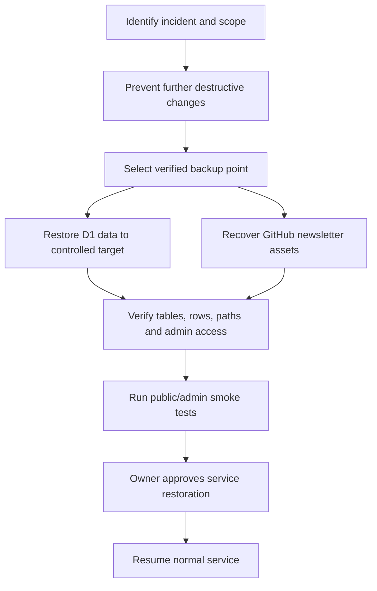

# 18 — Backup and Disaster Recovery

## Current status

Owner says the production backup and restore process is unknown. This is a significant documentation gap. No tested D1 restore or GitHub asset recovery evidence was provided.

## Data to protect

1. D1 application records. The previous migration output listed `admins`, `sessions`, `newsletters`, but the 1 November 2026 D1 dashboard screenshot reports 0 tables. Confirm the live schema before designing a backup/restore procedure.
2. Newsletter PDFs and cover images in GitHub repository storage.
3. Relevant Worker configuration/binding and secrets (secret values must be securely managed, not included in backups or docs).
4. Render configuration and environment variable names/settings.
5. `peoplejuris-website` Worker configuration, custom domain association, and DNS/route settings; also preserve `peoplejuris-db-api` Worker configuration and its `DB` binding.
6. Source code and deployment history in GitHub/Cloudflare/Render.

## Recovery dependencies

- D1 data restore requires an appropriate Cloudflare backup/export and target selection.
- GitHub repository files can be recovered through Git history if present, but repository history is not a guaranteed operational backup and deletion/force-push or retention can affect recovery.
- Sessions may be allowed to expire or invalidated after a restore; admin password and Recovery Code availability must be confirmed.
- The Worker must be configured to use the restored database binding.

## Disaster recovery workflow (proposed; not verified)

## Required future verification

Document actual backup schedule, export method, retention, encryption/access controls, restore target, recovery point objective, recovery time objective, and last successful restore test. Until then, these values are **Unknown**. Do not call a backup procedure verified.
