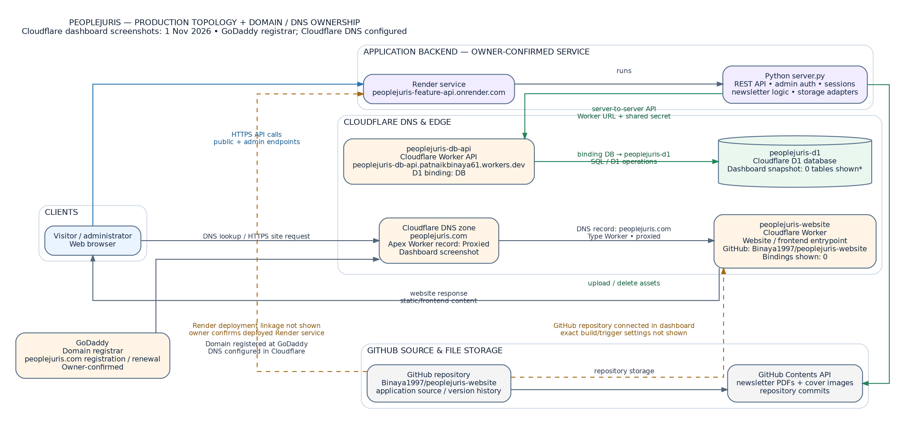
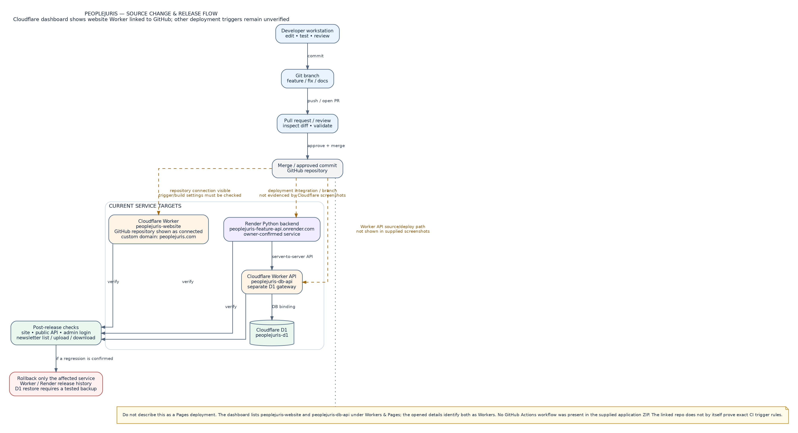
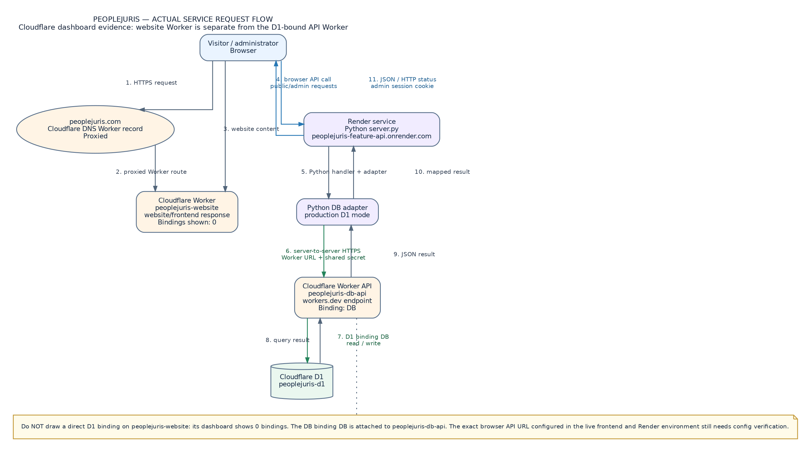
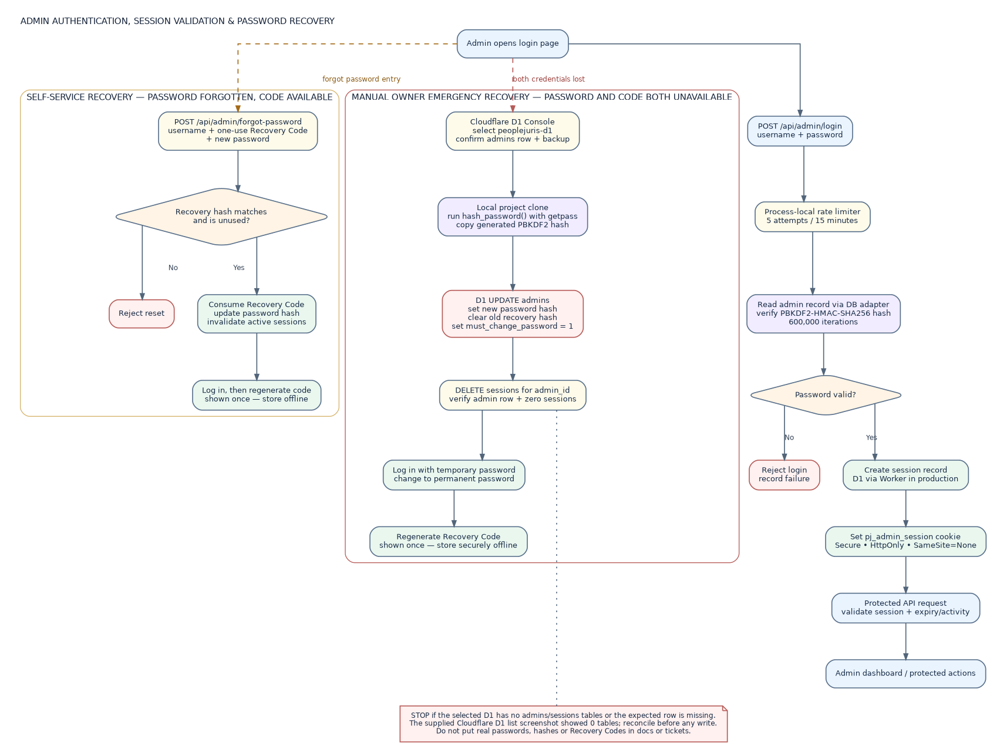
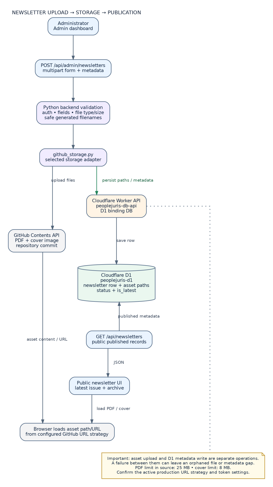
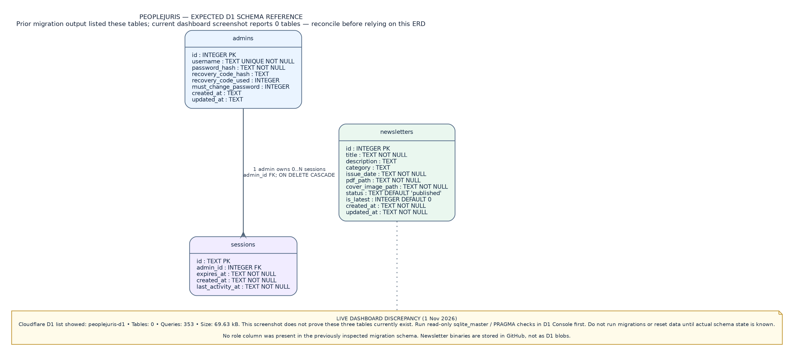
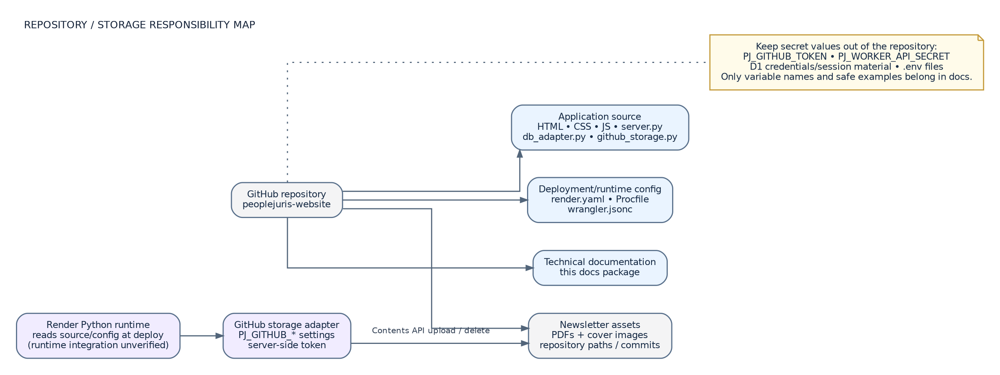

# 22 — Visual Architecture and Workflow Diagrams

This page collects the rendered technical diagrams. PNG files can be viewed in any image viewer; SVG files remain sharp when zoomed; `.dot` files are editable Graphviz source. The Cloudflare-specific diagrams were updated using the screenshots supplied on 1 November 2026. The platform diagram distinguishes GoDaddy domain registration from Cloudflare DNS/edge routing.

## 1. Cloudflare-verified platform architecture

[SVG](diagrams/01-platform-architecture.svg) · [Graphviz source](diagrams/01-platform-architecture.dot)

Correctly distinguishes the `peoplejuris-website` Worker (apex website entry point, zero bindings shown) from the separate `peoplejuris-db-api` Worker (D1 binding `DB` → `peoplejuris-d1`). It also shows the owner-confirmed Render backend and GitHub newsletter storage. Dashed deployment arrows mark unverified trigger details.

## 2. Deployment and change flow

[SVG](diagrams/02-deployment-and-change-flow.svg) · [Graphviz source](diagrams/02-deployment-and-change-flow.dot)

Shows the website Worker GitHub association visible in the Cloudflare list, distinct Render and D1 API Worker release targets, and post-release checks. It does not claim automatic deployment triggers that were not verified.

## 3. Public and admin request flow

[SVG](diagrams/03-public-and-admin-request-flow.svg) · [Graphviz source](diagrams/03-public-and-admin-request-flow.dot)

Shows browser → apex domain → website Worker for page delivery, and browser → Render → D1 API Worker → D1 for application data. It explicitly avoids drawing a D1 binding on `peoplejuris-website`.

## 4. Admin authentication and recovery

[SVG](diagrams/04-admin-authentication-and-recovery.svg) · [Graphviz source](diagrams/04-admin-authentication-and-recovery.dot)

Shows password verification, session creation, protected requests, one-time Recovery Code reset and session invalidation. A source-level initial-admin fallback is called out for review; it is not an instruction to use it.

## 5. Newsletter publishing and asset flow

[SVG](diagrams/05-newsletter-publishing-data-flow.svg) · [Graphviz source](diagrams/05-newsletter-publishing-data-flow.dot)

Shows the split between GitHub-stored binary assets and D1-stored newsletter metadata. The file upload and metadata write are separate operations and can partially fail. The D1 schema presence still needs live verification.

## 6. D1 entity relationship reference

[SVG](diagrams/06-database-entity-relationship.svg) · [Graphviz source](diagrams/06-database-entity-relationship.dot)

Shows the three tables in previously supplied migration output (`admins`, `sessions`, `newsletters`). **Important:** the latest D1 list screenshot reported zero tables. Treat this ERD as a previous/expected schema only until read-only queries confirm the active database schema.

## 7. Repository and storage responsibilities

[SVG](diagrams/07-repository-and-storage-map.svg) · [Graphviz source](diagrams/07-repository-and-storage-map.dot)

Shows where source/configuration/docs and newsletter assets reside, and highlights secrets that must remain in server-side secret configuration.

## Diagram notation and evidence rules

- **Solid arrows**: relationships supported by Cloudflare dashboard evidence, supplied source, or owner confirmation.
- **Dashed arrows**: deployment relationship exists or is indicated, but exact trigger/build rules are not verified.
- **Gold note boxes**: operational caution or missing evidence.
- **Red note/edge**: security-sensitive behavior or rollback hazard requiring deliberate review.
- Cloudflare dashboard screenshots are a point-in-time snapshot from 1 November 2026; they are not a continuous health check.

## Manual Owner emergency recovery

The admin recovery diagram includes the manual D1 branch for the case where both the password and Recovery Code are unavailable. The exact commands and SQL are documented in [Admin Authentication and Recovery](11-admin-authentication-and-recovery.md#manual-d1-emergency-recovery--password-and-recovery-code-unavailable).
