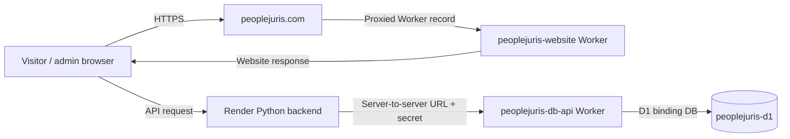

# 23 — Cloudflare Dashboard Evidence Audit

## Purpose and snapshot date

This page records what the Cloudflare dashboard screenshots supplied by the project owner on **1 November 2026** show. It is an evidence map for onboarding and future troubleshooting, not a live health check. The screenshots do not authorize or require any configuration change.

## Domain registrar and DNS provider (owner confirmation + Cloudflare evidence)

The project owner confirms that `peoplejuris.com` is registered with **GoDaddy**. The Cloudflare dashboard screenshot shows the `peoplejuris.com` DNS zone and its proxied apex `Worker` record targeting `peoplejuris-website`.

- GoDaddy: domain registrar for `peoplejuris.com` (owner-confirmed).
- Cloudflare: configured DNS provider; the supplied dashboard shows the domain's DNS zone and proxied apex Worker record targeting `peoplejuris-website`.

This distinction matters. GoDaddy handles domain registration and renewal; Cloudflare manages DNS records and edge routing. GoDaddy is not the normal live HTTP hop for each visitor request. No registrar, nameserver, or DNS settings were changed.

## Screenshot-by-screenshot findings

### 1. D1 Database list

Visible details:
- Database: `peoplejuris-d1`.
- Tables: `0`.
- Queries: `353`.
- Size: `69.63 kB`.
- Created at: `Oct 31 2026, 3:17 AM` (as displayed).

What this proves: the Cloudflare database list contains a database with the name `peoplejuris-d1` and shows the listed point-in-time statistics.

What this does not prove: that `admins`, `sessions`, or `newsletters` currently exist in this database. The displayed zero table count conflicts with prior migration output. Verify the live schema in D1 Console using read-only queries before any write or migration.

### 2. Workers & Pages application list

Visible applications:
- `peoplejuris-website`, showing `peoplejuris.com + 1 other route` and the GitHub repository badge `Binaya1997/peoplejuris-website`.
- `peoplejuris-db-api`, showing `peoplejuris-db-api.patnaikbinaya61.workers.dev`.

This list identifies two separate deployed applications. The product navigation is named **Workers & Pages**, but the opened detail screens below show the actual Worker-level configuration. Do not translate the navigation label into an assumption that the current production site is a Pages project.

### 3. `peoplejuris-website` detail view

Visible details:
- Custom domain: `peoplejuris.com`.
- `workers.dev` domain shown as Disabled.
- Bindings: `0`.
- `Workers`: `0` and the panel says no workers are bound to this worker.

Together with the DNS record screenshot, this supports the role of `peoplejuris-website` as the public website Worker for the apex domain. The zero-binding display means the diagram must not show this Worker holding D1 binding `DB`.

### 4. `peoplejuris-db-api` detail view

Visible details:
- Worker URL: `peoplejuris-db-api.patnaikbinaya61.workers.dev`.
- Bindings: `1`.
- Binding type: D1 database.
- Binding name: `DB`.
- Target: `peoplejuris-d1`.

This is the Worker that the dashboard shows as attached to D1. It is separate from `peoplejuris-website`.

### 5. DNS records for `peoplejuris.com`

Visible record:
- Name: `peoplejuris.com`.
- Type: `Worker`.
- Content: `peoplejuris-website`.
- Proxy status: Proxied.

Cloudflare also displays the recommendation: visitors cannot reach `www.peoplejuris.com`; add an A, AAAA, or CNAME record and optionally a redirect to the apex. The visible 11-record list does not show a `www` record.

No `www` record, redirect, custom domain, route, nameserver, or other DNS setting was created or edited while preparing this audit. The recommendation is informational. Any future DNS action must be separately reviewed and explicitly approved by the owner.

## Corrected service relationship



The Render API URL and Python/Worker integration are supported by owner confirmation and prior source inspection, not by the Cloudflare screenshots themselves. Exact browser API origin, current Render environment variables, Worker secret configuration and deployed API Worker source still require inspection.

## Immediate read-only checks before any D1 operation

In Cloudflare D1 Console, select `peoplejuris-d1` and run individually:

```sql
SELECT name, type FROM sqlite_master
WHERE type IN ('table', 'index')
ORDER BY type, name;

SELECT name FROM sqlite_master
WHERE type = 'table' AND name NOT LIKE 'sqlite_%'
ORDER BY name;
```

Then, only if those tables are listed:

```sql
PRAGMA table_info('admins');
PRAGMA table_info('sessions');
PRAGMA table_info('newsletters');
```

If no application tables are returned, stop. Confirm that the selected database, Cloudflare account, `DB` binding target, and migration history are correct. Do not run migrations, schema creation, resets or seed commands merely to resolve the dashboard statistic.

## Outcome

The Cloudflare diagrams and chapters in this documentation package have been updated to show:

- GoDaddy as the domain registrar and Cloudflare as the configured DNS zone/edge provider.
- `peoplejuris-website` as the public apex-domain Worker, not Cloudflare Pages.
- `peoplejuris-db-api` as the separate D1 API Worker.
- D1 binding `DB` on `peoplejuris-db-api` → `peoplejuris-d1`.
- A zero-binding state on `peoplejuris-website` as displayed.
- The unresolved D1 zero-table discrepancy.
- The `www.peoplejuris.com` DNS recommendation as an open issue, not a change request.
